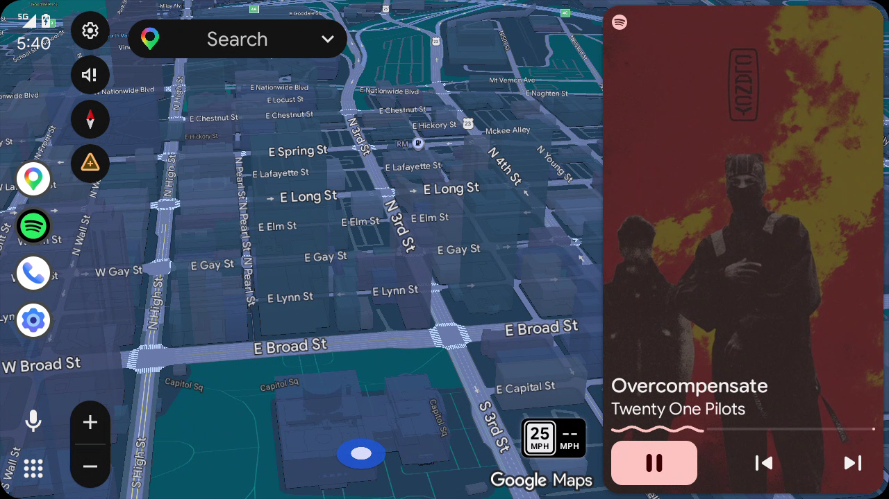
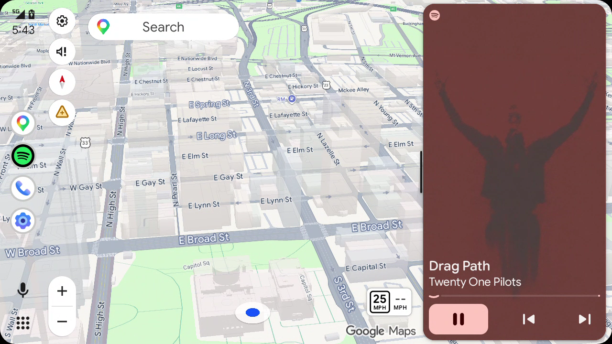
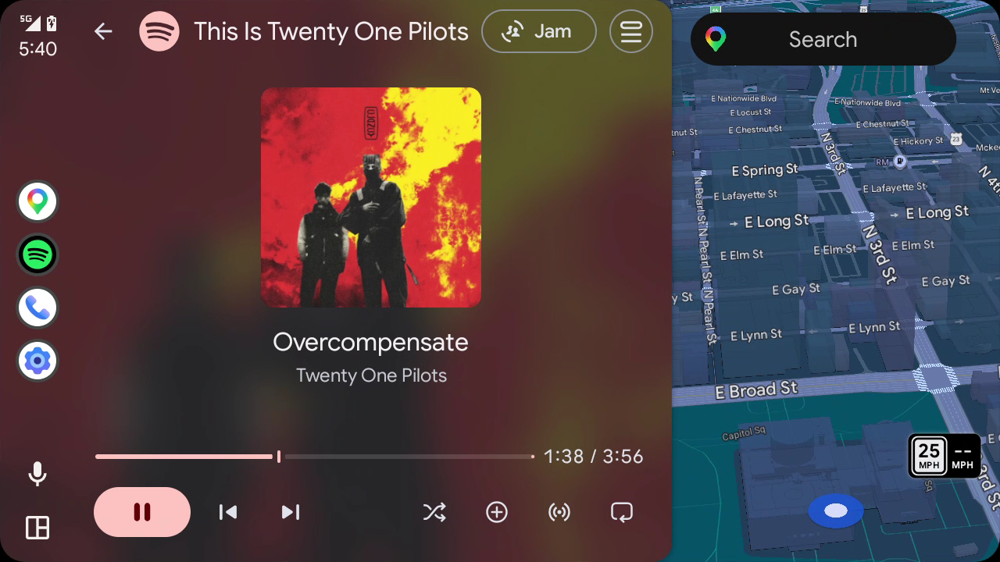
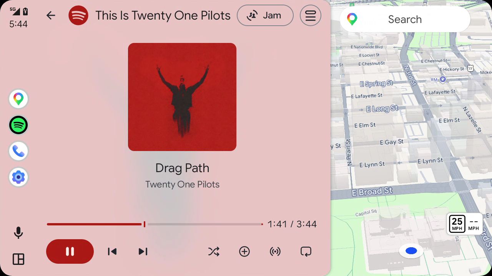
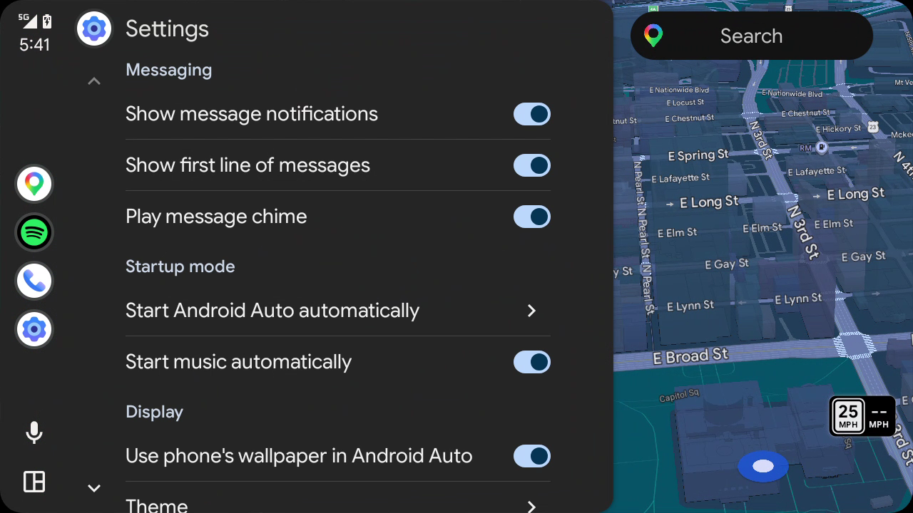
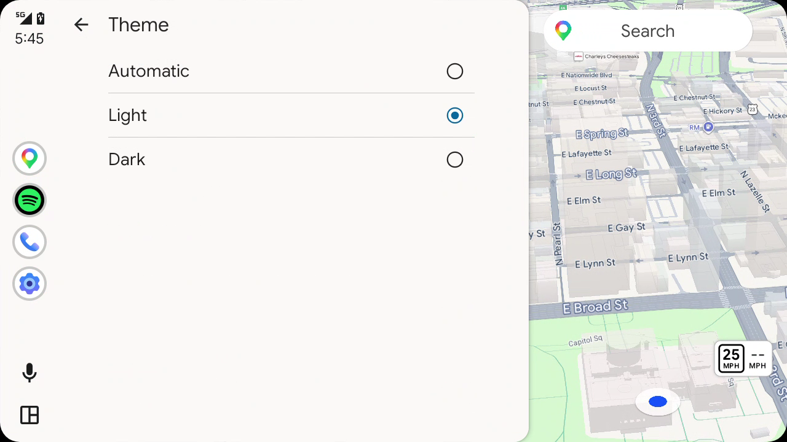

# EnableCielo
Enable Android Auto's new UI in testing, Cielo, on a rooted device.
And yes, this is an AI-generated tool. On the one hand, I do have significant concerns about AI and do not use it for cognitive offloading. On the other hand, no one has made this tool yet. This was only tested on my primary phone, a Google Pixel 8a. 

Android Auto 18.1 already contains Google's redesigned Material 3 Expressive system UI (code name **Cielo**) and its home-screen widget system (code name **Earth**). Google keeps both switched off with server-side flags. On a rooted phone you can switch them on yourself with one command, using the small `aa-tweak` tool in this repo.



## What changes

The map runs edge to edge, and the app rail and map buttons float over it instead of sitting in a black bar. Apps pick up colors from what they show (the media player tints itself to the album art), the app launcher sits on your phone's wallpaper, and light and dark themes both get the new look. The widget system switches on too: Android Auto starts its widget manager and loads Google's default widgets (Pixel Weather and the analog Clock).

| Dark | Light |
| --- | --- |
|  |  |
|  |  |
|  |  |

What has been confirmed so far, on Google's Desktop Head Unit at 1280 x 720:

- The new layout appears on screen, and `disable` restores the classic layout.
- The widget manager starts and loads its default widgets (visible in Android Auto's debug dump).
- A draggable widget panel appears behind the media card, with a small handle on the card's left edge. Opening it needs a real touchscreen drag, which the Desktop Head Unit can't send, so the widgets themselves haven't been seen on screen yet.

## Before you start

You need a rooted phone and Android Auto 18.1. Widgets also need Android 17. Everything here was tested on a Pixel 8a running Android 17 (build CP3A.261005.005) with KernelSU and Android Auto 18.1.664444.

| Requirement | Why |
| --- | --- |
| Root (Magisk, KernelSU or APatch) with a working `su` | The flags live in Google Play services' private database, which only root can write |
| Android Auto 18.1 or newer | Older builds don't contain the new layout code. Newer builds may rename or remove these flags |
| Android 17 (API 37) for widgets | Android Auto checks for API 37 before it turns widgets on. The new layout has no version check, but it was only tested on Android 17 |
| A wide car screen for widgets | Android Auto skips the widget area on narrow screens. The code checks for roughly 750 to 850 dp of width |
| A computer with ADB, or a root terminal on the phone | To run one command as root. Termux with `su` works |

Know the risks before you start:

- These are unreleased Google features. They can be unfinished or buggy, and any Android Auto or Play services update can change or remove them.
- The tool edits Google Play services' flag database. It saves the original values first, and `disable` puts them back.
- Set this up while parked. Don't test it while driving.

## Step 1: Get aa-tweak

`aa-tweak` is one small Java program (about 20 KB). It runs as root through Android's built-in `app_process`, so nothing gets installed. Its full source is [`src/AaTweak.java`](src/AaTweak.java).

1. Download [`release/aa-tweak.dex`](release/aa-tweak.dex), or build it yourself (below).
2. Copy it to the phone's temp folder. From a computer with USB debugging on:

    ```bash
    adb push aa-tweak.dex /data/local/tmp/
    ```

    Without a computer, download it on the phone, then run this in a root terminal such as Termux:

    ```bash
    su -c cp /sdcard/Download/aa-tweak.dex /data/local/tmp/
    ```

3. Check the file. `sha256sum /data/local/tmp/aa-tweak.dex` should print the hash in [`release/SHA256SUMS`](release/SHA256SUMS):

    ```text
    99380e20edb3b6890c18e35d425a94ed7c887a7247ef7d02e4a8dcbcad0bd5fa
    ```

### Build it yourself

You need a JDK (11 or newer) and the Android SDK with `build-tools` and one recent platform, such as `platforms;android-36`.

- Mac or Linux: `ANDROID_HOME=/path/to/sdk ./build.sh`
- Windows: `powershell -ExecutionPolicy Bypass -File .\build.ps1` (uses `ANDROID_HOME`, or the default SDK location)

Both write `build/aa-tweak.dex`. Builds of this source with JDK 21 and JDK 26 and build-tools 36.0.0 produced the same file as the release, so your hash should match too.

## Step 2: Turn it on

One command does everything, then you reconnect to the car.

1. Open a root shell: `adb shell`, then `su`. In Termux, just `su`. Approve the root prompt.
2. Run the `widgets` preset:

    ```bash
    CLASSPATH=/data/local/tmp/aa-tweak.dex app_process /system/bin AaTweak enable widgets
    ```

    Or run it straight from a computer in one line:

    ```bash
    adb shell "su -c 'CLASSPATH=/data/local/tmp/aa-tweak.dex app_process /system/bin AaTweak enable widgets'"
    ```

3. Wait for `Android Auto restarted`. The tool then prints a status table.
4. Reconnect to the car: unplug and replug the cable, or turn wireless Android Auto off and on.

Pick the preset that matches what you want:

| Preset | Turns on | Tested |
| --- | --- | --- |
| `layout` | The new Material 3 Expressive layout only | Yes, on screen |
| `widgets` (recommended) | The layout plus the widget system. Needs Android 17 | Layout on screen; widget manager confirmed in the debug dump |
| `all` | `widgets` plus the extra dashboard flags | No. It hides the right-hand dashboard card on a 1280 x 720 screen |

Running `enable` with a bigger preset adds to what is already on. To drop back to a smaller preset, run `disable` first, then enable the smaller one.

Tip: in a root shell, `alias aa-tweak='CLASSPATH=/data/local/tmp/aa-tweak.dex app_process /system/bin AaTweak'` lets you type `aa-tweak status` from then on.

## Step 3: Check it worked

The quickest check is the car screen: with the new layout, the map shows behind the app rail on the left. To check from the phone, run `status`:

```bash
CLASSPATH=/data/local/tmp/aa-tweak.dex app_process /system/bin AaTweak status
```

After `enable widgets`, the first four rows should match. This is the output from the test phone:

```text
Android API 37, Android Auto 18.1.664444-release
flag                                                 override       Android Auto sees
CieloFeature__cielo_status                           system_theme   system_theme
CieloFeature__cielo_focus_enabled                    true           true
CieloFeature__earth_enabled                          true           true
CieloFeature__earth_status                           CAR.SYS        CAR.SYS
CieloFeature__use_draggable_dashboard                -              (default)
CieloFeature__earth_dashboard_widget_combo_enabled   -              (default)
CieloFeature__earth_mini_dashboard_card_enabled      -              (default)
```

With the car connected, two log checks from a computer confirm what Android Auto actually did:

- Layout: `adb logcat -d | grep "Will use layout"` should name a `sys_ui_cielo_layout_...` layout. The classic one is `sys_ui_layout_...`.
- Widgets: `adb shell dumpsys activity service com.google.android.projection.gearhead | grep -A4 WidgetStack` should list the default widgets.

## Turn it off again

`disable` removes every override the tool added, puts back the original values it saved, and restarts Android Auto. Reconnect to the car afterwards.

```bash
CLASSPATH=/data/local/tmp/aa-tweak.dex app_process /system/bin AaTweak disable
```

The original values are kept in `/data/local/tmp/aa-tweak/` until you run `disable`, so don't delete that folder while the tweak is on. On the test phone, `disable` brought back the classic layout and Google's own value for `cielo_focus_enabled` (false).

Last resort: clearing Google Play services' storage also wipes the overrides, along with your other Play services data on the phone.

## How it works

Android Auto reads its feature flags from a compressed snapshot that Google Play services builds for it. `aa-tweak` changes the flags at the source and in that snapshot:

1. It adds rows to Play services' override table (`phenotype.db`, table `flag_overrides`) and links them to Android Auto's current config. Play services copies active overrides into each new config it builds, so the change should survive Google's syncs.
2. It patches the snapshot Play services shares with Android Auto (`app_phenotype_shared/<app id>/<hash>.pb`, a raw-deflate list of flags), so the change applies right away.
3. It sends Play services' `phenotype.UPDATE` broadcast so Android Auto refreshes its own cached copy, then restarts Android Auto.

The obvious shortcuts don't work on a normal phone. Play services' `FLAG_OVERRIDE` debug broadcast only accepts allowlisted apps, Android Auto's `overrides.txt` is only read on debug builds, and editing Android Auto's own cached copy changes nothing.

| Flag | Set to | Google's default | Effect |
| --- | --- | --- | --- |
| `CieloFeature__cielo_status` | `system_theme` | empty | Switches to the new `sys_ui_cielo_layout_*` layouts |
| `CieloFeature__cielo_focus_enabled` | `true` | `true` (served as `false`) | Lets the new layout turn on even when the car doesn't report a touchscreen |
| `CieloFeature__earth_enabled` | `true` | `false` | Turns on the widget system (Android 17 only) |
| `CieloFeature__earth_status` | `CAR.SYS` | empty | Second switch the widget system checks |
| `CieloFeature__use_draggable_dashboard` | `true` | `false` | `all` only. Draggable dashboard panel; untested |
| `CieloFeature__earth_dashboard_widget_combo_enabled` | `true` | `false` | `all` only. Widgets mixed with dashboard cards; untested |
| `CieloFeature__earth_mini_dashboard_card_enabled` | `true` | `false` | `all` only. Mini dashboard card; untested |

## Troubleshooting

| What you see | Fix |
| --- | --- |
| `Run this as root (su).` | Run `su` first, or put the whole command after `su -c "..."` |
| `Android Auto isn't registered with Play Services yet` | Connect to a car with Android Auto once, then run `enable` again |
| `No shared config snapshot found` | Same as above: Play services creates the snapshot after Android Auto's first sync. If it persists, your Play services version stores flags differently and this tool won't work |
| `status` shows an override but `Android Auto sees (default)` | Run `enable` again, then fully disconnect and reconnect the car |
| The car still shows the classic layout | Disconnect for at least 10 seconds and reconnect. Wireless users: turn Android Auto's wireless option off and on |
| No widgets | Check you are on Android 17 and your car screen is wide enough. Widgets are the least-tested part of this guide |
| The new look disappears days later | Google pushed a new config. Run `status`, and `enable` again if needed |

Tested only on a Pixel 8a (Android 17, KernelSU), Android Auto 18.1.664444 and Google's Desktop Head Unit 2.1. Results in real cars and on other phones may differ.
